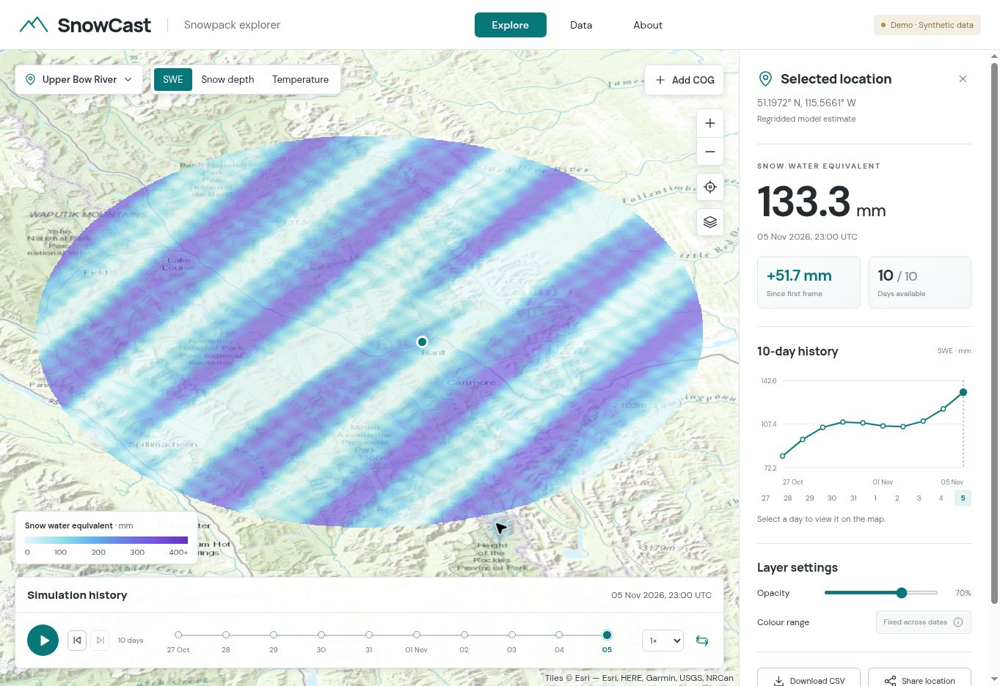
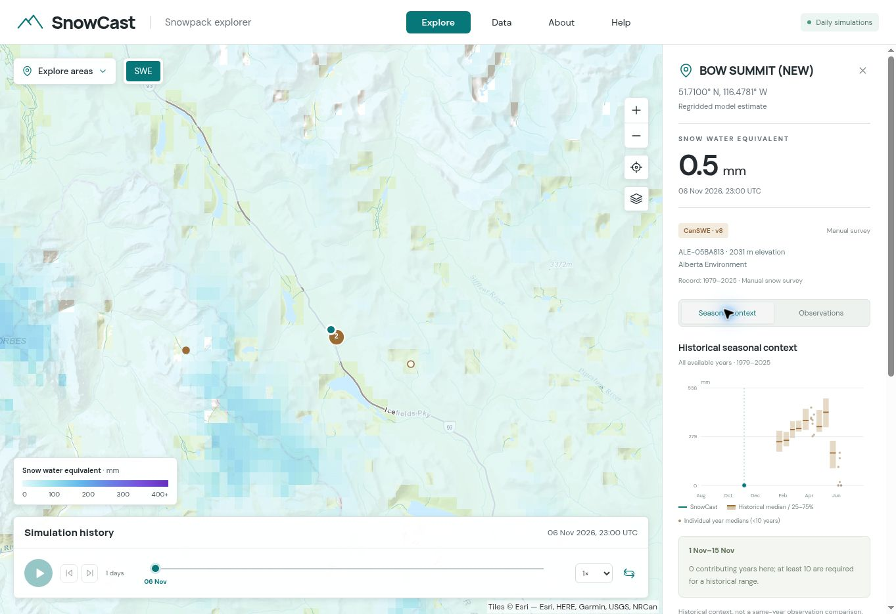
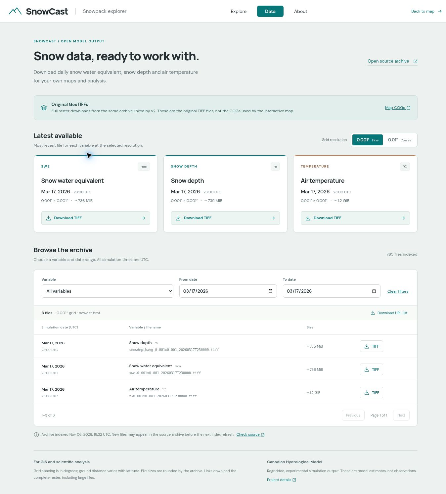
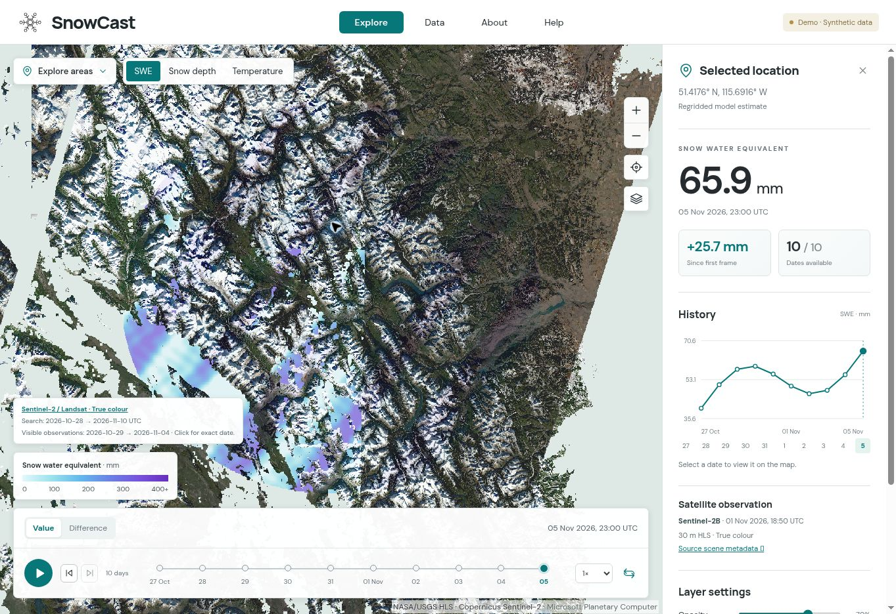

# SnowCast explorer (v3)

A static Svelte/TypeScript + OpenLayers viewer for numeric Cloud Optimized
GeoTIFFs from the published model catalogue. It provides daily playback,
a full-resolution point history, point CSV downloads, shareable links, and a responsive
map/inspector layout. There is no application server, database, S3 dependency,
or connection from the public browser to the model's compute environment.

## Compare two dates

Switch the timeline from **Value** to **Difference**, then choose **From** and
**To** independently. The map shows **To − From** for SWE, snow depth or air
temperature. Swap reverses the subtraction; comparing a date with itself gives
zero wherever data is valid. SWE and snow depth use brown for decreases and
blue for increases. Air temperature uses blue for cooling and red for warming.
The neutral midpoint is zero. Symmetric colour limits stay fixed across pairs:
±400 mm SWE, ±2 m snow depth and ±35 °C temperature for the default catalogue.

The browser range-reads the two existing numeric COGs and subtracts aligned
native tiles before styling and map reprojection, with both WebGL and Canvas
rendering. Both date masks must be valid. Missing data is never treated as zero;
incompatible grids/overviews and failed reads report an error. No pairwise COGs
or publisher changes are needed. Display overviews are subtracted at their
existing resolutions; point values use the full-resolution rasters.

Point details show the two endpoint values and their signed difference.
**Difference CSV** exports both UTC timestamps, both values, the difference,
units, coordinates and status. Shared location links retain the date pair.
Point history charts continue to show absolute values. In Difference mode,
CanSWE displays observations only: model curves, markers, legends and same-date
model columns are hidden, and chart scaling uses observations alone. Switch
back to Value to restore the model comparison.
Dates and legends follow the successfully rendered pair while another loads.

Comparisons cover dates retained in `catalog.json`: up to ten recent daily dates,
plus one SWE and snow-depth snapshot per older Monday–Sunday UTC week within
a hydrological year running September 1–August 31, selected by the latest model
date. For example, a latest date of November 9, 2026 only includes map history
from September 1, 2026 onward. Temperature retains recent daily dates only.
Map history resets on September 1, including the recent daily window, which
grows back to ten days as the new year progresses. The default
viewer history remains the recent ten days; choose **Daily + weekly archive**
to browse older snapshots, compare dates, and sample their point histories.
Weekly entries are the latest available daily snapshots in their calendar week,
not weekly averages. No missing days are interpolated. Other original TIFFs on
the downloads page are not automatically available for map comparisons. A
shared pair that has expired is reported instead of silently substituted.



## How the COGs are generated

The existing model pipeline remains:

1. CHM writes UGRID output.
2. `chm_ugrid2grid` conservatively regrids SWE, snow depth, and temperature.
3. `postprocess/publish_cogs.py` copies those numeric TIFFs using GDAL's COG
   driver (via Rasterio), adding internal 512-pixel tiles, DEFLATE compression,
   and average overviews. Numeric COGs use **Float32**, retaining the source
   grid, masks and scale/offset; values and nodata are rounded to Float32.
   Only display overviews are spatially averaged. Original downloadable TIFFs
   retain their original precision and are never modified.
4. The publisher writes immutable, timestamp/content-versioned files and an
   atomic `catalog.json`. The browser styles the numeric values at runtime.
   Retention is selected before hashing/conversion, so unused archive dates are
   not converted. Previously published weekly COGs survive source-TIFF rotation.

The map publisher selects **0.001x0.001** source TIFFs by default. Coarse 0.01°
files remain available in the original-TIFF downloads but cannot overwrite
fine-grid map dates. `--grid DXxDY` explicitly selects another filename grid;
the actual pixel spacing must be within 0.1% of that nominal spacing, in the
raster's CRS units. This accommodates fitting domain bounds to integer raster
dimensions. Within each variable, all retained dates must have matching CRS,
shape and cell alignment, using the browser's much tighter alignment tolerance.
An alignment failure leaves the previous catalogue untouched.

On the first publication after this change, previously catalogued rasters at
other resolutions are omitted with a warning. Dates with available target-grid
originals are rebuilt; dates without them are omitted rather than sampled at a
different resolution. Existing target-grid dates are retained when their source
TIFFs are no longer available. The synthetic demo explicitly selects its own grid.

An equivalent single-file conversion using your existing GDAL installation:

```bash
gdal_translate input.tiff output.cog.tif -of COG -ot Float32 \
  -co COMPRESS=DEFLATE -co PREDICTOR=YES -co BLOCKSIZE=512 \
  -co OVERVIEW_RESAMPLING=AVERAGE -co OVERVIEWS=IGNORE_EXISTING -co BIGTIFF=IF_SAFER
```

Do not colourize the TIFF before this step. A COG containing RGB colours does
not contain the numeric values needed for point queries. A `.tif` suffix alone
also does not establish that a file is a COG.

The publisher casts through a small VRT, so conversion does not require a
full-size intermediate TIFF or loading the whole raster into memory. Encoding
`float32-v1` is included in catalogue assets and filenames. After upgrading,
run the normal publisher/upload pipeline: retained dates with available source
TIFFs are regenerated once even if their source hash has not changed. Later
runs skip unchanged Float32 assets. Include the archive input directory to
rebuild dates whose originals have moved there. Dates without an available
source remain usable in their previous encoding until replaced or expired.
New URLs prevent browsers/CDNs from reusing cached Float64 bytes; the uploader
still transfers the files before switching the catalogue. No catalogue edits
or manual deletion are needed.

Source content identities include the TIFF and GDAL-reported sidecars, including
external validity masks and auxiliary metadata. Adding, revising or removing a
sidecar invalidates the published asset. This replaces the former TIFF-only
hash and rebuilds available source datasets once on upgrade. Moving a dataset
and its sidecars together from the current directory to the archive keeps the
same identity. `catalog.json` is made publicly readable (0644) before its atomic
replacement, including when the publisher runs with a restrictive umask.

## Hosting on an ordinary disk

Yes: keep files on a normal filesystem and serve them with Nginx or Apache.
The browser requires an HTTP(S) URL, not a filesystem path. A disk on an HPC
login node is sufficient only if a web server can expose it; otherwise use the
included rsync publisher to copy the COGs onto the web host's disk.

The important server behaviour is **actual byte-range GET support**: a request
for `Range: bytes=0-1023` must return `206 Partial Content` and those bytes.
`Accept-Ranges: bytes` alone is not proof. Do not gzip/brotli-compress TIFFs in
HTTP responses. Allow CORS if the viewer and data have different origins.

Suggested layout, with the compiled application and data deployed separately:

```text
/var/www/html/v3/index.html
/var/www/html/v3/assets/...
/var/www/html/v3/data/catalog.json
/var/www/html/v3/data/cogs/swe/20261105T230000-<hash>.tif
```

Nginx configuration for a directory outside the document root:

```nginx
# Inside your HTTPS server block. alias points to an ordinary disk directory.
location /snowcast-data/ {
    alias /srv/snowcast/webdata/;
    gzip off;
    add_header Cache-Control "public, max-age=31536000, immutable" always;
    # Only needed if the UI is on a different origin; these data are public.
    add_header Access-Control-Allow-Origin "*" always;
    add_header Access-Control-Expose-Headers "Content-Range, Accept-Ranges, Content-Length" always;
}
location = /snowcast-data/catalog.json {
    alias /srv/snowcast/webdata/catalog.json;
    add_header Cache-Control "no-cache" always;
    add_header Access-Control-Allow-Origin "*" always;
}
```

Nginx normally supports ranges for static files without an extra directive.
Disable any inherited third-party HTTP compression for `.tif` as well. With
Apache, use `Alias` + a read-only `<Directory>` configuration and the same
cache/CORS response headers; its static-file handler supports byte ranges.
Never expose the simulation's checkpoint or credential directories.

Check the deployed endpoint:

```bash
python scripts/check_cog_host.py https://www.snowcast.ca/v3/data/cogs/swe/FILE.tif
# If data and viewer use different origins:
python scripts/check_cog_host.py https://data.example/snowcast-data/cogs/swe/FILE.tif \
  --origin https://www.snowcast.ca
```

With `--origin`, the check verifies both origin permission and exposure of
`Content-Range` to browser JavaScript through `Access-Control-Expose-Headers`.
Headers visible to Python alone are insufficient for the viewer.

## Build and deploy

Use Node 22.12+ (Node 24 recommended) to build; Node is not needed on the server.

```bash
cd webui
npm ci
npm run check
npm test
npm run build
```

Upload `dist/` to `/v3/`. Keep `data/` separate from application synchronization.
For example, from `webui/`:

```bash
rsync -rt --exclude=data/ --exclude=demo/ dist/ USER@HOST:/var/www/html/v3/
```

Do not point the legacy `/v2/` rsync mirror at `/v3/`, and do not blindly use
`--delete` over a directory containing data. The existing v2 viewer is untouched.
The application uses relative asset URLs and works in a `/v3/` subdirectory.
By default it requests `./data/catalog.json`. For an external data server, use:

```text
https://www.snowcast.ca/v3/?catalog=https%3A%2F%2Fdata.example%2Fsnowcast-data%2Fcatalog.json
```

Asset URLs inside the catalogue are resolved relative to the catalogue itself.
Use the trailing slash on `/v3/` (or configure the web server's directory redirect).
Esri topographic is the default basemap. The layers button opens a picker for
OpenStreetMap, Esri topographic, Esri satellite, or None (model data only).
The choice is saved in this browser and in the page URL; an explicit
`?basemap=osm`, `terrain`, `satellite`, or `none` takes precedence over the saved
choice. `?basemap=auto` resets to Esri topographic. Switching basemaps does not
reload the COG layer, reset the date, or clear the selected point.

The OpenStreetMap source uses the official HTTPS tile endpoint, visible linked
attribution, normal browser caching/referrer behavior, and no basemap prefetch.
Follow the [OSM tile usage policy](https://operations.osmfoundation.org/policies/tiles/);
the community tile service is best-effort and is not an offline/bulk tile source.
Check the chosen provider's capacity and terms for your deployment. Selecting
None removes the basemap source so it schedules no new basemap requests.
Font loading uses Google Fonts with system-font fallbacks; it is independent
of data access. A different basemap provider may improve a particular network
path, but is not a measured guarantee of faster loading on every device.

## Help and About

[Help preview](docs/help-preview.png) · [About preview](docs/about-preview.png)

The **Help** button opens a popup on the map, Data and About pages. Its SWE and
snow-depth definitions come from the v2 website (`website/index.html`); air
temperature and v3-specific date, colour and point-value instructions complete
the guide. Opening Help on the map pauses playback without changing the view,
selected variable, date or point. Loading diagnostics remain accessible there.

**About** is a separate `about.html` build entry. It reuses the v2 CHM description,
ECCC–University of Saskatchewan collaboration credits, research caveat, mesh
figure and publication list. The Windmapper DOI is corrected to
`10.1029/2022WR032683`; old v2 domain extents and forecast-only UI instructions
are omitted. About does not initialize a map or fetch raster data. Legacy
`?panel=about` links redirect to this page; `?panel=help` opens the Help popup.
Deploy the complete `dist/` output, including `about.html` and its assets.

## CanSWE observation stations



Map layers includes a remembered **CanSWE stations** toggle (off initially), a
name/ID search, and manual/automated marker keys. Nearby sites cluster; clicking
a cluster zooms in, then offers a record list for co-located stations. Clicking
a station pauses playback and samples the existing full-resolution model raster
at its coordinates. On phones the comparison panel scrolls into view.

The panel offers historical seasonal context (median and 25–75% range), dated
observations by snow season, original observation CSV downloads with quality
flags, and shareable station links. SWE and snow depth follow the selected map
variable; temperature explicitly has no CanSWE comparison. Snow-depth absence
is never converted to zero. The existing Model CSV remains a separate download.

This is the public **CanSWE v8 archive through July 2025**, not a current-season
feed. Seasonal context uses all available station years and independent
half-month bins, with one contribution per year. Ranges require ten years;
shorter records show individual year medians. Reference periods, sample counts,
flags, and terrain-representativeness limitations are visible in the panel.
See [snapshot provenance and processing](data/README.md) for the precise method.

In Value mode, both comparison tabs keep the available SnowCast series visible.
Difference mode shows CanSWE observations without a model overlay. In Observations,
the season picker changes only the historical observations; model and observation
seasons are labelled separately and aligned by month/day. Model coverage dates
are shown explicitly. The table's **Same-date model** column still requires an
exact calendar-date match in UTC; an overlay from a different year is not a match.

The committed 6.3 MB bundle includes 750 western-Canada stations. `npm run dev`
and `npm run build` automatically extract the static assets using Python's
standard library. Builds require no CanSWE network access or netCDF4 install.
The station index loads when stations are enabled (including shared station
links); each compressed history is fetched on
selection and cached (up to eight stations). Model rendering never waits for
observations, and no model reads occur for unselected station markers.

Deploy the entire `dist/observations/canswe/` directory with the rest of `dist/`.
No new service, COG rebuild, or PNG tile generation is required. Serve
`observations/canswe/index.json` with revalidation/short caching; versioned
station history filenames can be cached immutably. Station `.json.gz` files
work either as ordinary gzip files or with `Content-Encoding: gzip`.

## Daily GeoTIFF and ASCII downloads



The header's **Data** link opens `downloads.html`, a separate, lightweight page
that does not initialize the map or fetch any rasters. It offers the latest
original SWE, snow-depth and temperature GeoTIFFs at 0.001°, plus AEP ASCII
grids at 0.036° where available. The format/grid filter applies to latest links,
the archive table, and URL exports. Legacy 0.01° TIFFs are omitted. It includes
inclusive UTC date filters, file sizes, pagination and a filtered URL-list export.
The original files remain at
<https://hpfx.collab.science.gc.ca/~chm003/tiff/> and
<https://hpfx.collab.science.gc.ca/~chm003/asc/>; the page does not convert them
to COGs or relay large downloads. Map COGs remain accessible via `?panel=data`.

The TIFF directory does not currently return browser CORS headers, so the page reads
a small same-origin `download-index.json` instead. `npm run build` refreshes it
using Python's standard library. It fetches only the two directory listings, validates
filenames, and writes the index atomically. An offline build retains the checked-in
snapshot with a warning. The page displays the snapshot's indexing time, actual
simulation timestamps, and an explicit stale-index notice after 48 hours.

**Keep the archive current between UI deployments:** the normal v3 uploader now
refreshes and atomically publishes this index after uploading the COG catalogue.
It reads the public TIFF and ASCII listings after the normal pipeline's upload;
it does not depend on a frontend rebuild. The index goes in the parent of the
remote data directory (`/var/www/html/v3/` for `/var/www/html/v3/data`). For a
different layout, set `webui_download_index_dir` or pass
`--download-index-directory` to `webupload/v3.py`.

To update the download links immediately from the simulation/upload host, without
retransferring COGs or rebuilding the UI:

```bash
python webupload/v3.py --downloads-only \
  --host root@snowcast.ca --directory /var/www/html/v3/data
```

A failed refresh retains the live index and logs a warning without undoing a
successful COG publication. The standalone `--downloads-only` command returns a
failure status if it cannot refresh or upload the index.

For directly served local data, or as an independent scheduled refresh on the
web host (for example hourly, or after upstream TIFF publication):

```bash
python /path/to/SnowCast/scripts/index_tiff_downloads.py \
  --output /var/www/html/v3/download-index.json
```

Alternatively, run `npm run refresh:downloads` and upload just
`webui/public/download-index.json` to `/v3/download-index.json`. No frontend
rebuild is needed for an index refresh. A failed/empty refresh keeps the previous
index intact. Do not overwrite a more recent server index with an older build
snapshot. The data-archive link follows the selected format and remains available
if the index cannot load. Both listings must succeed before replacing the index.
No download date is inferred from the COG catalogue, and absent files are never
shown as download links. Source sizes are rounded Apache-index values, displayed
as approximate binary sizes. Grid spacing is angular, not a fixed metre size.

The downloadable archive remains daily, including older dates; map COG retention
does not thin or delete these original downloads. Missing published files remain
gaps. For offline indexing, pass both `--listing tiff.html` and
`--ascii-listing ascii.html`.

## Publish the initial ten-day window

From the repository root, with Rasterio/GDAL available (already in `spack.yaml`):

```bash
python postprocess/publish_cogs.py \
  --input postprocess/archive_tiff --input postprocess/tiff \
  --output postprocess/webdata --days 10
```

The last input directory wins if archive and current directories contain the
same variable/time. The publisher merges prior published assets, so incremental
two-record exports still build a ten-day history. It anchors the window to the
latest available simulation date, including that date and the previous nine
UTC dates; missing days remain missing. Old files are not silently converted
into observations. Model run IDs can be supplied with `--run-id` if known;
publication time is recorded separately and is never passed off as run time.

If the data directory is directly served by your web server, publication is
complete. To copy it to another host:

```bash
python webupload/v3.py --data postprocess/webdata \
  --host USER@HOST --directory /var/www/html/v3/data
```

This copies referenced COGs first, then transfers a catalogue snapshot and
publishes it atomically on the remote filesystem. The host needs **Python 3.9+**
(standard library only); the uploader sends the helper code over SSH. The local
publisher and uploader share a filesystem lock. Before transferring assets, the
uploader pins its catalogue on the host; remote cleanup protects all such pins.
The remote catalogue switches only after every referenced file exists with its
expected size and public permissions: 0755 on the data root and COG directories,
0644 on referenced rasters and `catalog.json`. Both publishing and uploading
repair permissions on reused files, including files created under umask 0077.
Ancestors outside the data root must already allow the web server to traverse them.
Publication timestamps preserve microseconds and increase under the local store
lock even when the clock repeats or moves backwards. A late older upload cannot
replace a newer catalogue; equal timestamps are accepted only for identical
catalogues. A conflicting equal timestamp fails without replacing the live
catalogue; republish locally to create a new version. Keep one production source
directory per destination.

SSH/rsync failures are retried up to 10 attempts per upload step, with a
30-second delay that doubles after each failure (the same schedule as v2).
This applies to both normal uploads and `--downloads-only`. Catalogue and
download-index publication retries restage the same snapshot before publishing it,
so a disconnect after a successful remote rename can recover safely. COG
transfer failure after all attempts still fails the upload; download-index
failure after a successful COG publication remains a warning. No delay is
added after the last failed attempt.

For automatic publishing after each model run, set in `config_hrdps_west.py`:

```python
settings['webui_enabled'] = True
settings['webui_keep_days'] = 10
settings['webui_weekly_days'] = None  # SWE/SD weekly since September 1; 0 disables weekly history
settings['webui_upload_host'] = 'USER@HOST'  # omit for directly served local disk
settings['webui_upload_dir'] = '/var/www/html/v3/data'
```

This is opt-in until the real host is configured. Model physics, output cadence,
checkpoint retention, existing AEP exports, and the legacy v2 path are unchanged.

Original-TIFF rotation moves external masks, PAM metadata and overviews together
with their raster, counting retention by TIFF rather than sidecar. With
`webui_data_dir` configured it shares the publisher lock, preventing publication
midway through rotation. Source sidecars are removed only after their TIFF has
been transferred successfully.

COG retention and cleanup are automatic on both machines. The publisher defaults
to `--days 10` plus weekly SWE/SD snapshots since September 1 of the hydrological
year containing the latest model date (UTC), not the publication date or a rolling
365-day window. It never hashes or converts source dates outside that year.
The optional `--weekly-days N` caps history within that year; `--weekly-days 0`
disables the weekly archive. Leave it unset (`webui_weekly_days = None` in the
configuration) to retain the full hydrological year, including leap years.
The catalogue records `retention.hydrological_year_start`; `window_days` is capped
at the number of days since September 1 so the viewer does not show previous-year
gap slots during the first nine days. There is at most one timestamp
per UTC day and one snapshot per older calendar week for each snow variable.
A week with no output contributes no snapshot. Each expired or superseded COG
is kept for **48 hours after it first becomes unreferenced**, allowing existing
browser sessions to finish. Cleanup never uses file mtime as its age criterion.
Reintroducing a file into a catalogue or upload pin resets its grace period.
Catalogue and pin references must use canonical paths (no `./` or repeated `/`);
invalid references stop cleanup before any deletion. Referenced COGs cannot use
symlink aliases. Only publisher-named COGs under `cogs/swe`, `cogs/snowdepthavg` and `cogs/t` are
eligible; originals, unrelated files and symlinks are not removed. Missing or
invalid catalogue/pin/state data stops cleanup without deleting files.

Every successful publication/upload reports active and managed COG bytes and
cleanup totals. At the measured November sizes, a full hydrological year would
reach about 23 GB of active COGs, with additional space required during the 48-hour grace
period, revisions and the initial migration/backfill. A 25 GB allocation is tight;
this is a retention policy, not a hard quota or guarantee of seasonal file sizes.
The first run only backfills selected weekly dates within the current hydrological
year where source TIFFs are available. Existing COGs from previous years leave the
catalogue and enter the same 48-hour cleanup grace period. Original daily TIFF
and ASCII download archives, including earlier hydrological years, are unchanged.
Older dates without either an original or a published COG cannot be recovered.

To preview cleanup without deleting COGs or starting any grace clocks:

```bash
python -m postprocess.cog_store cleanup postprocess/webdata --dry-run
```

To inspect the web host using the same stdlib-only helper from your updated repo:

```bash
ssh root@snowcast.ca 'python3 - cleanup /var/www/html/v3/data --dry-run' < postprocess/cog_store.py
```

Omit `--dry-run` to record unreferenced files and remove those already past the
grace period. Regular publisher/uploads do this automatically; no extra cron is
needed. Do not remove `.cog-cleanup.json` while relying on its recorded grace
periods. A process crash releases its local lock. Failed uploads unpin their
snapshot when the host is reachable; otherwise the next upload from the same
machine/source directory replaces that stale pin. If permanently retiring that
source, remove its specific `.uploads/*.json` pin only after confirming no upload
from it is running. Pins from active uploads must be preserved.

## Areas of interest

The **Explore areas** dropdown offers the full current model extent and
nine Canadian Rockies research sites listed by
[GWFO](https://gwfo.ca/instrumented-sites.php): Marmot Creek, Fortress Mountain,
Burstall Creek, Sibbald Wetlands, Lake O’Hara, Bow River Headwaters (Bow Hut),
Helen Creek, Peyto Glacier, and Athabasca Glacier.

`src/lib/areas.ts` records each site's published centre and source URL. The
4–8 km viewing radii are navigation windows, not watershed boundaries. Choosing
a site pauses playback and changes only the viewport; variable, date and sampled
point are preserved. Sites outside the current catalogue bounding
box are hidden. Being inside that box does not guarantee non-nodata coverage.
These shortcuts display SnowCast model output, not GWFO observations.

[Dropdown preview](docs/area-picker-preview.png), captured with the local
single-frame SWE validation catalogue. Desktop and 390 px phone-layout checks
cover site navigation, full-domain reset, date/point preservation, and dismissal.

## Data semantics and limitations

- SWE is in mm, snow depth in m, temperature in °C, following existing SnowCast
  plotting metadata. Verify upstream units when adding a new variable.
- The daily viewer uses the latest valid timestamp in each UTC day. It does
  not silently blend forecast runs. A future forecast-run selector would need
  explicit forecast provenance and lead-time metadata.
- All dates are UTC; there is no inference of “current” from the hour of day.
- Point values come from the containing full-resolution raster cell, with
  affine/CRS transformation, nodata/mask handling, and scale/offset applied.
  They are regridded values, not original CHM triangle values.
- Colours use one fixed range per variable across dates, with nearest-neighbour
  display interpolation. Overviews may aggregate pixels; the point value never
  depends on map zoom. Zero and nodata are distinct.
- SWE, snow depth, and temperature use transparent missing-data pixels in both
  renderers. The WebGL colour expression explicitly checks the validity band
  and the raw nodata sentinel before scaling/colour mapping. Valid zero snow
  and valid temperatures below the legend minimum remain visible by default.
- **Hide zero snow** under Layer settings optionally masks exactly zero SWE
  and snow depth in Value mode, after scale/offset conversion. It works with
  Canvas and WebGL, updates cached dates without reopening COGs, and leaves
  nonzero snow, temperature, Difference mode, point values, charts and downloads
  unchanged. The choice is saved locally; `?hideZeroSnow=1` enables it and
  `?hideZeroSnow=0` disables it, overriding the saved choice. Shared point links
  include the current setting. It is off by default.
- Missing dates and failed point reads produce gaps in charts and CSV. The
  reported change requires a valid first frame and a valid selected frame.
- Playback waits for the selected raster's viewport to render before changing
  the displayed timestamp. Basemap loading does not hold back a ready raster.
  Direct byte-range reads bypass geotiff.js 3.1's shared block cache: a live
  zoomed SWE check reproduced an internal `AggregateError: Request failed`
  after every HTTP request had succeeded, with required blocks missing from
  that cache. Decoded OpenLayers tile caching remains enabled. Each open file
  pins its first 64 KiB to coalesce TIFF header and tile-index reads. Concurrent
  metadata reads share one request; a cancelled tile stops waiting without
  cancelling the header needed by other tiles. Disposing the frame cancels the
  transfer, and failed prefixes are not cached. Reads outside the prefix remain
  direct ranges. Diagnostics count actual network attempts/bytes and report
  `metadataHits` separately. This cache applies to both map renderers.
  Remote raster range reads share a six-request limit across map frames and
  retry transient network/body failures or HTTP 408/429/500/502/503/504 up to
  twice. Responses must match their requested byte ranges and body lengths;
  a server returning the entire COG or a permanent HTTP error fails explicitly.
  Abandoning a frame cancels its queued transfers and retries. The limit covers
  map COG reads; basemaps and point samples have separate request handling.
  After 15 seconds the viewer shows a slow-loading notice and continues waiting;
  it reports a stall only after 90 seconds without raster loading progress.
  It retains up to three raster layers; point reads run with at most three
  concurrent requests. Playback pauses in hidden tabs.
- Tile errors remain monitored after a frame is displayed, including pan/zoom.
  Canvas rejects an image containing failed tiles rather than displaying those
  tiles as transparent model nodata. It retains the last good layer image while
  reporting the failure. Retry reopens the source, clearing failed tile caches.
- Both renderers keep the Web Mercator map view (EPSG:3857), matching v2.
  WebGL styles and reprojects numeric raster tiles. Canvas styles native-grid
  values in a worker, then reprojects the resulting RGBA image using Canvas 2D;
  it does not invoke GPU float-data reprojection. Both paths use the same
  full-resolution point sampler and preserve transparent missing pixels.
- Automatic rendering retries a WebGL tile failure or 90-second loading stall
  once with Canvas, retaining the map view, selected frame, and point. It saves
  Canvas as this browser's preference only after the retry renders successfully.
  Other devices keep their own preference. A failure in both modes is reported.
  An identified HTTP failure is reported directly rather than retried with a
  different renderer.
- The viewer loads rasters from the published catalogue; there is no local-file
  or individual COG URL import workflow. Published rasters support EPSG:4326,
  EPSG:3857, standard WGS84 UTM, and other projections defined by `proj4` in the
  catalogue. Remote raster hosting requires range support and CORS.
- Share links preserve variable, selected date, and point. The exact history
  can expire when it leaves the rolling catalogue; download CSV for a snapshot.
- Error states never silently substitute synthetic data.

## Development and validation

```bash
python -m pip install rasterio numpy pytest
python -m pytest -q tests
cd webui
npm ci
npm run demo
npm run dev
```

Open the development URL with `?demo=1`. All demo rasters are synthetic and the
viewer displays a prominent label. The demo generator and catalogue use exactly
the same COG publisher as real data. Generated demo files are ignored by git;
exclude `demo/` when deploying the public application.

Before production, run the hosting check and compare a few clicked points
against Rasterio/GDAL samples from your actual rasters, including outside-domain
and nodata cells. Test the actual host with desktop and mobile browsers. Synthetic
fixtures validate functionality, not performance with full-size production data.
The initial browser QA exercised the Canvas fallback (the test browser had no
WebGL), daily playback, point histories, CSV
export, share links, and the missing-catalogue state. The ten demo point values
were independently compared with Rasterio. GPU rendering and mobile devices
still need verification on the deployment host.

Loading regressions cover a 35-second response, continuous progress over several
minutes, a genuinely stalled transfer, and cancellation during date changes.
Browser QA also delayed the initial temperature COG response by 35 seconds:
the slow-loading notice appeared, then the frame rendered successfully without
a retry. [Screenshot with synthetic data](docs/temperature-loading-check.jpg).

## Diagnosing slow laptop loading

The initial map now waits for the catalogue and fits its actual domain before
requesting tiles. Previously, WebGL kept the placeholder Upper Bow view even
when the catalogue covered a much larger area. Display rendering is capped at
2× pixel density and four million pixels per map canvas; a resize recomputes
that limit. This affects display detail only, never full-resolution point reads.
Switching away from an unfinished frame aborts its remote COG requests and
disposes that frame instead of allowing abandoned loads to accumulate.

After deploying the rebuilt UI, open **About → Map diagnostics / slow loading**,
or **Loading diagnostics** in a slow-loading/error notice. While the map is
stuck, refresh the snapshot and copy it. It shows the actual rendering path,
viewport/display pixel ratio, projections, COG state, raster rendering state,
the saved/requested renderer preference, any automatic fallback reason, and
separate raster/basemap pending, settled and failed tile counts. After automatic
recovery it also retains the original WebGL failure snapshot. Counts are
per source instance, not percentages of the current viewport; settled tiles
can include requests the renderer no longer needs. Pending raster tiles may
be downloading, decoding or reprojecting, so this is not a network trace.
The report omits URLs, coordinates and GPU identifiers.
It includes the variable/time, actual tile error, and HTTP attempt counters.
`rasterRequests.lastError` records the last failed request attempt (including
ones later recovered), its phase, and HTTP status when available. These distinguish
HTTP/network/body failures from later TIFF decoding or tile-rendering errors.

The dialog offers reversible comparisons (each reloads the page):

- `?detail=low`: cap display density at 1× to compare a lower graphics workload.
- `?renderer=canvas`: use and remember compatibility rendering, keeping the
  Web Mercator view. This can be slower on some machines.
- `?renderer=auto`: reset the saved renderer preference and enable automatic
  recovery. `?renderer=webgl` explicitly forces WebGL without automatic recovery
  for troubleshooting. Explicit URL options override the saved preference.
- `?basemap=none`: remove the basemap to isolate COG loading/rendering. This is
  also available as None in the basemap picker, without reloading the page.

Parameters can be combined; the same links restore automatic behavior.
Compare one change at a time, and
compare phone/laptop on the same Wi-Fi without a VPN before attributing a
difference to graphics or the host. The affected laptop loaded successfully
with the earlier native-grid Canvas path, but failed in WebGL with no basemap
requests. That narrows the issue to the rendering paths; it does not establish
a specific GPU-driver or network cause. Canvas now preserves the requested
Mercator view without numeric-data GPU reprojection. The build and automated
tests cover the change; its local preview was blocked in the cloud test browser.
Renderer tests cover remembered choices and one-time recovery. Projection tests
exercise OpenLayers' native-to-Mercator image requests, readiness, and disposal.
A Canvas 2D integration test checks actual output pixels at known geographic
locations (including nodata and valid zero) while rejecting WebGL requests.
Its native Canvas dependency is used only by tests, not shipped to browsers.
Additional regressions cover transient HTTP failures, interrupted/truncated
responses, permanent range errors, queued/retrying request cancellation, and
a failed tile after an initially successful Canvas frame followed by recovery.
Transparency regression checks evaluate the generated colour expression with
OpenLayers, compile it to GLSL, and check Canvas output for missing values,
masked pixels, valid zero snow, and cold temperatures. These are not a substitute
for a visual WebGL check on the affected device.

## Sentinel-2 / Landsat satellite overlay

Open **Map layers → Sentinel-2 / Landsat** to enable recent 30 m HLS imagery.
The layer is off by default, draws above the model and below station markers,
and has an independent opacity slider. It works with both model renderers.

- **Latest clear observations** fills each display pixel with the newest valid
  observation from either Sentinel-2 or Landsat 8/9 in the past 3, 7 (default),
  14 or 30 UTC calendar days, including today. It does not average observations.
- **Single acquisition day** restricts both collections to one UTC day. The
  imagery selection is independent of model animation and difference dates.
- **True colour** uses red/green/blue. **Snow false colour** uses SWIR1/NIR/red;
  snow and ice appear cyan, water clouds white, and ice clouds can also be cyan.
- The map caption reports the search window and the acquisition-date range of
  loaded visible tiles. Click the map to see the satellite, acquisition time and
  source-scene metadata for the actual displayed pixel in the location panel.
- Areas without valid observations remain transparent. Cloud/shadow filtering
  is imperfect, especially over bright snow. This is visual context, not a
  validated snow-cover classification or SWE measurement.

### Data and hosting

NASA HLS v2 is served by Microsoft Planetary Computer's public STAC and tile
APIs (`hls2-s30` and `hls2-l30`). No visitor account, API secret, Python service,
CHM processing change or Apache configuration change is required. The mirror's
archive starts in 2020. HLS itself typically has 2–3 days of processing latency;
mirror ingestion, clouds and winter darkness can make the latest clear image
older. Both sensors are rendered at 30 m (Sentinel-2 is resampled from its native
resolution). The overlay is a third-party network dependency; provider outages
are reported separately and never interrupt model playback.

The tile service renders three reflectance bands plus explicit alpha derived
from Fmask. Bits 1–3 (cloud, cloud adjacency, shadow) are excluded; snow/ice and
water flags are retained. QA fill (255) and reflectance fill (-9999) are excluded.
Equivalent SWIR1/NIR/red bands are B11/B8A/B04 for S30 and B06/B05/B04 for L30.
The browser composites opaque valid pixels newest-first across **both**
collections and retains a per-pixel scene index for provenance. Failed scene
requests fail that tile instead of silently falling back to older observations.
Only documented outside-footprint 404 responses are treated as missing coverage.

Imagery starts at map zoom 7 and uses source tiles up to zoom 12 (then
overscales). Requests are limited to four at a time, with cancellation and
20-second catalogue / 45-second tile timeouts. Neighbouring tiles reuse catalogue
searches, pagination is checked, and excessive results produce an explicit error
rather than a truncated mosaic. Image/provenance caches are bounded. Changing
opacity reuses imagery; disabling or changing imagery dates/view aborts requests.
**Refresh / retry imagery** clears the imagery source and repeats catalogue searches.

Settings are encoded in the page URL and retained by **Share location**:
`?satellite=1&sat-mode=latest&sat-days=7&sat-view=snow&sat-opacity=0.85`, or
`?satellite=1&sat-mode=date&sat-date=2026-11-04&sat-view=true-color`.

References: [NASA HLS products](https://hls.gsfc.nasa.gov/data-products/),
[Planetary Computer HLS](https://planetarycomputer.microsoft.com/dataset/group/hls2),
[STAC API](https://planetarycomputer.microsoft.com/api/stac/v1/),
[tile API](https://planetarycomputer.microsoft.com/api/data/v1/docs).


